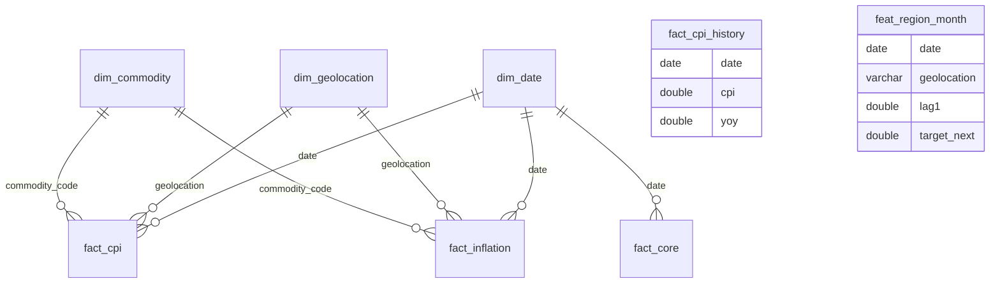

# Price Signals — Philippine CPI Analytics

Public web app for PSA OpenSTAT consumer-price data: a 3D Philippines map drives
every panel. Built for the MIT 118 group project (Saint Louis University, Baguio City).

**Stack:** FastAPI · DuckDB over Parquet · vanilla ES modules · three.js (map) · Plotly.js (charts).

## Quick start

```bash
python -m pip install -r requirements.txt
uvicorn app.main:app --reload --port 7860
```

Open <http://localhost:7860>. The committed warehouse and model artifacts make the
app start without a build step.

## Tests

```bash
python tests/test_api.py      # API contract + <1,000-row guard
python tests/test_geo.py      # polygon ↔ warehouse crosswalk (run once)
```

## Architecture

```
Browser (ES modules, no bundler)
  ├─ store.js        single state: region, date range, focusDate, metric, sector
  ├─ map3d.js        three.js extruded choropleth, raycast pick, keyboard select
  ├─ api.js          abortable fetches, dedupe cache, CSV exports
  └─ panels/*        overview · forecast · drivers · risk · structure · data

FastAPI
  ├─ routers/meta.py       /api/health · /api/meta · /api/sql/{panel} · /api/export
  ├─ routers/panels.py     KPIs, map, series, drivers, calendar, distribution, table
  ├─ routers/forecast.py   forecast (POST), classifier, SHAP, residuals, metrics
  ├─ services/forecast.py  SARIMA + ETS, basket-weight shock, LRU cache
  └─ db.py                 DuckDB views + guarded queries (<1,000 rows)
```

## Data model



Facts are partitioned Parquet (`data/warehouse/fact_*/*/*.parquet`); dimensions are
single files. `feat_region_month` is the model-ready derivative.

## Region crosswalk

`data/geo/geo_key_map.csv` maps all 18 warehouse regions to exactly one GeoJSON
polygon (`scripts/build_geo.py`). No aggregate rows are mapped; every mapped region
is reachable from the map, combobox and ranked list.

## Reproducibility

Build path (from the parent project): `scripts/fetch_psa_data.py` →
`pipeline/build_warehouse.py` → `models/train_models.py`. This app serves the
committed artifacts; the data vintage is shown in the rail (2026-11-05).

## Deploy (Docker, HF Spaces / Render)

```bash
docker build -t price-signals .
docker run -p 7860:7860 price-signals
```

Hugging Face Spaces (Docker SDK): push this folder, port 7860.
Render: create a Web Service from the Dockerfile. Note the free-tier memory/limit
risks in `specs.md` §14.

## Honesty notes

- Forecasts are decision-support estimates, not official PSA/BSP projections.
- Missing months are absent, never imputed; outliers are flagged, not removed.
- Fold-level accuracy is shown separately; a blended number would hide the 2026 regime shift.
- The price shock uses the 2018 basket-weight approximation and is labeled as such.
